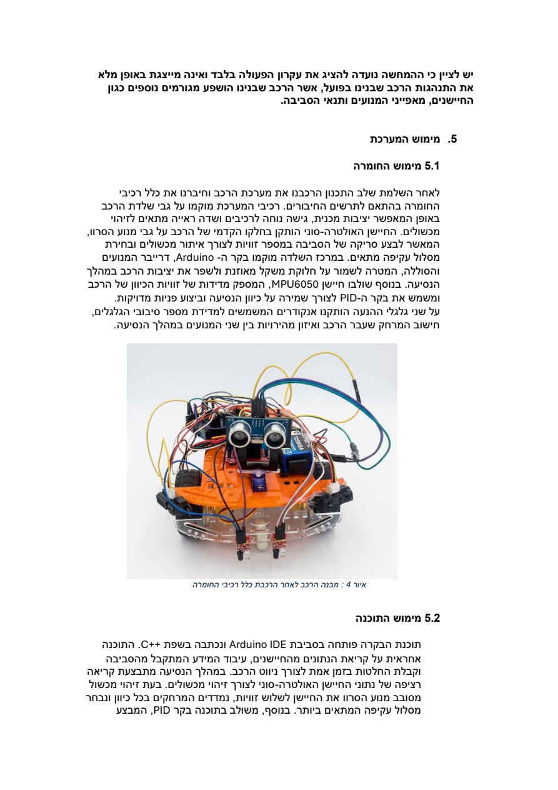

# Autonomous Navigation Robot: PID Control and Obstacle Avoidance

Academic team project, Mobile Robotics, Shenkar, 2026.

An Arduino Uno differential-drive robot that follows a predefined two-segment route and performs reactive obstacle avoidance. It combines MPU6050 gyro heading feedback, wheel encoders, and a servo-mounted HC-SR04 ultrasonic sensor.

## Navigation and control

- Gyro calibration at startup followed by integration of Z-axis angular rate to estimate heading.
- Heading PID with an additional left/right encoder-balance correction. The supplied gains are Kp=7.2, Ki=0.635, Kd=3.20 and KpEncoder=0.25.
- Encoder pulse counting through interrupts on D2/D3 and distance estimation from configured wheel geometry.
- A state machine drives the X segment, turns 90 degrees toward the Y segment, drives that segment, and stops.
- On detecting a nearby obstacle, the robot stops and scans right, center and left at servo angles 30, 90 and 150 degrees. It selects an available side and executes a predefined detour.
- Median-of-three filtering of ultrasonic readings, turn/drive timeouts during detours, and a cooldown between obstacle reactions.

The supplied sketch is configured for targetX=200 cm and targetY=-100 cm. These are program settings, not independently measured endpoint coordinates.

## Hardware

Arduino Uno, MPU6050, HC-SR04, SG90 scanning servo, L298N driver, two DC motors and two encoders.

| Function | Uno pin |
|---|---|
| Left / right encoder | D2 / D3 |
| Motor PWM ENA / ENB | D5 / D6 |
| Motor IN1-IN4 | D7-D10 |
| Ultrasonic TRIG / ECHO | D12 / D13 |
| Scanning servo | A1 |
| MPU6050 I2C SDA / SCL | A4 / A5 |

[Wiring diagram from the report](assets/wiring.png)

## Demonstrations

Three distinct recordings were supplied and retained without transcoding:

- [Demo 1, approximately 49 seconds](media/demo-01.mp4)
- [Demo 2, approximately 28 seconds](media/demo-02.mp4)
- [Demo 3, approximately 40 seconds](media/demo-03.mp4)

Selected frames show the robot moving among floor-level obstacles. No calibrated accuracy or success-rate measurement is derived from the recordings. Depending on the GitHub viewer, the MP4 links may download or open in a separate player.

## Results and limitations

The [course report](docs/report.pdf) describes straight driving, obstacle detection, avoidance and approximate completion of the planned route. Gyro drift, encoder calibration, wheel slip and motor mismatch limit physical accuracy. More obstacle maneuvers can increase accumulated error.

The software's x/y variables track route-segment progress rather than a complete global pose estimate. At completion the sketch explicitly assigns x/y to targetX/targetY, so printed final coordinates do not establish actual physical arrival accuracy. Detour distance is not fully integrated into a global position estimate. This is reactive navigation; no SLAM, mapping, GPS or optimal path planning is implemented.

The source also uses blocking delays and sensor reads. The configured wheel diameter is 2.5 cm and encoder resolution is 20 pulses/revolution; both require confirmation against the physical build. The 6.5 cm wheel in the report is a worked example, not the value used by this sketch.

## Source and setup

- [Arduino sketch](firmware/autonomous_robot/autonomous_robot.ino), preserved byte-for-byte from the supplied source.
- Dependencies: Wire, Servo and an MPU6050 library exposing initialize(), testConnection() and getMotion6(). The exact installed library version has not been supplied.
- Open the sketch with an Arduino Uno target, verify the wiring and library selection, and calibrate the motor, encoder and gyro settings for the actual hardware. Keep the robot still during gyro calibration.
- No compilation, new hardware run or new performance measurement was performed during portfolio preparation.

## Team and provenance

מתן רצאבי, בתאל ביטון, דרבה קאסה. A three-person academic team project. The existing LinkedIn project description identifies AI-assisted coding.

The PDF copy omits the original cover containing identification numbers and removes annotations; the original report is unchanged. Team credit is retained above.
